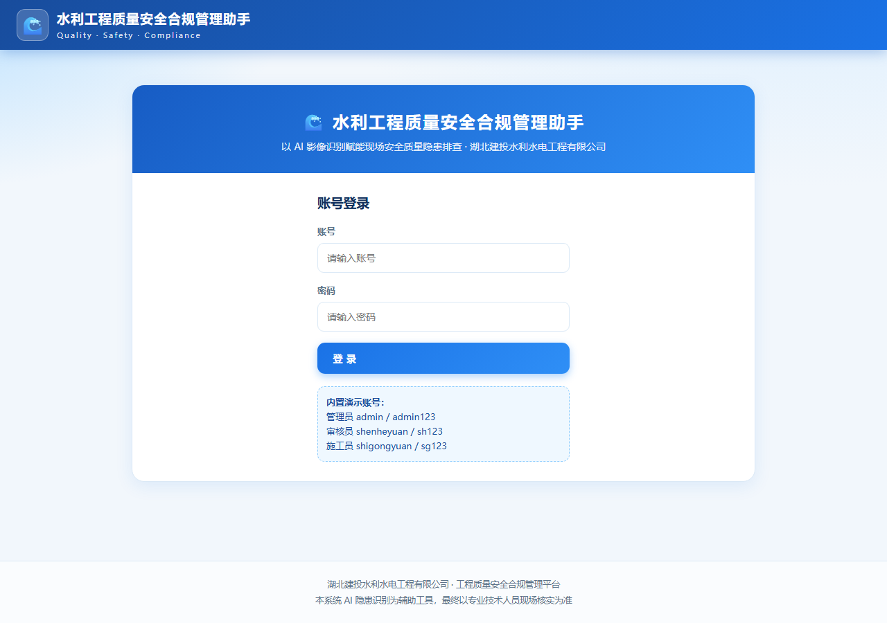

<div align="center">

# 🌊 水利工程质量安全合规管理助手

**面向水利施工企业的质量安全合规管理平台** — 以 AI 影像识别赋能现场隐患排查、审核与整改闭环

Quality · Safety · Compliance

[](LICENSE)
[]()
[]()
[]()

</div>

---

## 📖 目录

- [功能介绍](#-功能介绍)
- [内置演示账号](#-内置演示账号)
- [技术栈](#-技术栈)
- [快速开始](#-快速开始)
- [目录结构](#-目录结构)
- [AI 简介](#-ai-简介)
- [REST API](#-rest-api)
- [部署发布](#-部署发布)
- [许可协议](#-许可协议)

---

## 📷 界面预览



## 🚀 功能介绍

天蓝色水利工程设计风格，覆盖 **「排查 ➜ 审核 ➜ 整改 ➜ 销号」** 完整闭环：

| 模块 | 说明 |
| --- | --- |
| 🏠 **首页** | 公司简介、在建项目简介、问题及整改情况统计卡片、整改闭合进度条 |
| 🔐 **登录** | 账号密码登录，识别 **管理员 / 审核员 / 施工员** 三种身份 |
| 📸 **上传隐患** | 上传现场照片（可多选、自动压缩），调用 DeepSeek 多模态模型识别隐患并生成整改意见；AI 把握不足的项标记「需现场核实」 |
| 📤 **待审核** | 审核员确认施工员提交的问题、修改整改意见 |
| 📋 **整改台账** | 记录问题 → 审核确认 → 开始整改 → 已整改 → 销号的完整闭环 |
| 🤖 **AI 助手** | 多轮对话、流式打字输出、Markdown 渲染；回答自动结合真实台账数据，规范类问题自动联网检索权威来源 |
| 👥 **用户管理** | 管理员新增用户、调整身份 |
| 📖 **规范查询** | 30+ 部水利工程规范与法规，按类别检索并跳转权威平台 |
| ⚙️ **AI 接口** | 管理员配置 DeepSeek 接口（地址 / 模型 / API Key），保存即测试连通性 |

### 🔐 权限矩阵

- **管理员** — 全部功能权限（上传隐患、审核、整改台账、用户管理、AI 接口）。
- **审核员** — 上传照片审核、处理待审核、编辑整改台账。
- **施工员** — 上传现场照片、提交问题、落实整改，并删除其提交的问题。
- **删除问题** — 施工员 / 审核员 / 管理员均可删除。
- **编辑整改台账** — 仅审核员与管理员。

## 👤 内置演示账号

| 身份 | 账号 | 密码 |
| --- | --- | --- |
| 管理员 | `admin` | `admin123` |
| 审核员 | `shenheyuan` | `sh123` |
| 施工员 | `shigongyuan` | `sg123` |

> 登录后可在「用户管理」新增账号并为用户赋予任意身份。

## 🧱 技术栈

| 层 | 技术 |
| --- | --- |
| 前端 | 原生 HTML / CSS / JS 单页应用，无构建、无框架依赖 |
| 数据 | 浏览器 `localStorage`（静态模式，开箱即用）；可选 Node 后端 JSON 文件持久化（`backend/server/data/`） |
| 认证 | 前端本地密钥校验（静态模式）；可选后端 Bearer Token 会话 |
| AI | DeepSeek 多模态 / 对话 / 联网检索（OpenAI 兼容接口），密钥由用户在前端「AI 接口」页自行配置 |
| 后端（可选） | Node.js（内置 `http / https / fs / crypto`），**零第三方依赖** |

> 💡 **运行模式说明**：本项目前端为**自包含的纯静态应用**，数据存于浏览器并内置演示账号，因此可以直接部署到 **GitHub Pages** 等静态站点并登录使用。`backend/` 目录提供一套可选的 Node 后端（REST API + 服务端持久化），供需要多人共享、跨设备同步数据时使用。二者互不影响。

## ▶️ 快速开始

### 方式一：静态/ GitHub Pages（推荐，零配置）

直接把整个仓库发布到任意静态托管（**GitHub Pages / Nginx / Vercel / Netlify** 等），打开 `index.html` 即可：

- 数据保存在**浏览器本地**，内置演示账号可直接登录。
- **AI 识别 / AI 助手**需登录管理员在「AI 接口」页填入自己的 **DeepSeek API Key**；未配置时自动回退本地规则识别，不影响演示。
- 部署到 GitHub Pages 时无需任何后端配置，登录可正常使用。

### 方式二：Node 后端（多人共享数据）

环境要求：**Node.js ≥ 16**（无需安装任何依赖）。

```bash
# 在仓库根目录
node backend/server/server.js
# 或 npm start        （默认端口 8123，可 PORT 覆盖）
```

浏览器访问 **http://127.0.0.1:8123/** ，用演示账号登录。首次启动会自动在 `backend/server/data/` 生成数据并播种演示账号。

### 自测

```bash
node backend/server/test-api.js
```

脚本会临时占用 **8977** 端口，自动验证 24 项关键接口（登录、权限矩阵、用户、台账状态流转、AI 识别/对话、聊天历史、规范、退出），全部通过输出 `通过: 24 失败: 0`。

## 🗂 目录结构

```
water-quality-safety/
├─ index.html              页面骨架（引用 frontend/ 资源）
├─ frontend/               前端静态资源（由后端托管）
│  ├─ css/style.css        天蓝色水利风格样式
│  └─ js/
│     ├─ store.js          数据层（localStorage 持久化，内置演示账号，静态模式）
│     ├─ regulations.js    水利工程规范与权威链接数据
│     ├─ ai.js             AI 接口层（直接调用 DeepSeek，含本地规则回退）
│     ├─ md.js             轻量 Markdown 渲染器
│     └─ app.js            主逻辑（登录 / 上传 / 审核 / 台账 / 权限 / 规范 / AI）
├─ backend/
│  └─ server/              可选后端（零依赖 Node 服务，详见 backend/server/README.md）
│     ├─ server.js         HTTP 入口：路由 / 静态托管 / AI 代理 / SSE
│     ├─ db.js             数据存储层（JSON 文件持久化）
│     ├─ auth.js           认证与权限（token 会话 / 角色元数据）
│     ├─ ai.js             DeepSeek 代理 + 本地规则回退
│     ├─ assistant.js      AI 助手上下文与本地兜底回答
│     ├─ seed.js           内置演示账号种子
│     ├─ regulations.js    规范静态数据
│     ├─ test-api.js       API 自测脚本
│     └─ data/             运行时数据（自动生成，已 gitignore）
├─ docs/screenshots/       项目截图
├─ .gitignore
├─ .gitattributes
├─ LICENSE
└─ package.json
```

## 🤖 AI 简介

- **照片隐患识别**：DeepSeek 多模态模型 `deepseek-flash`，以 Base64 内嵌于 user 消息，依据水利安全质量规范输出 JSON（隐患标题 / 风险等级 / 规范条款 / 整改措施 / 是否需现场核实）。
- **AI 助手**：多轮对话 + 流式 SSE 输出 + 台账数据上下文 + 规范联网检索。
- **离线兜底**：未配置密钥或接口异常时自动回退**本地规则识别**，保证完整闭环演示。
- **密钥处理**：静态模式（GitHub Pages）下 API Key 由使用者在「AI 接口」页填入并保存在浏览器本地；使用可选 Node 后端时，密钥仅在服务器端保存。

## 🔌 REST API

后端提供完整的认证、用户、台账、规范、AI 代理与聊天历史接口，全部接口与字段见 **👉 [backend/server/README.md](backend/server/README.md)**。

核心路由示例：

| 方法 | 路径 | 说明 |
| --- | --- | --- |
| POST | `/api/auth/login` | 登录，返回 `token` |
| GET | `/api/issues` | 问题台账列表 |
| POST | `/api/issues` | 提交新问题 |
| PUT | `/api/issues/:id/status` | 状态流转（确认 / 整改 / 销号） |
| POST | `/api/ai/analyze` | 照片隐患识别 |
| POST | `/api/ai/chat/stream` | AI 助手流式对话（SSE） |

## ☁️ 部署发布

### 静态托管（GitHub Pages 等）✅ 可直接使用

本系统前端为**自包含纯静态应用**，可直接发布到 **GitHub Pages / Nginx / Vercel / Netlify** 等任意静态站点，**登录可正常使用**：

1. 将仓库整体推送到 GitHub。
2. 在仓库 **Settings → Pages**，选择分支的根目录作为发布源（也可沿用你当前 `qite1/-` 的 Pages 地址）。
3. 打开生成的页面即可；数据存于各浏览器本地，演示账号直接可登录。

> 说明：静态模式为单机（每台浏览器各自保存数据）。若多人共享数据，请改用下面的后端方式。

### 进程托管（多人共享数据）

使用可选 Node 后端，以**进程**方式运行（Node ≥ 16，零依赖）：

```bash
node backend/server/server.js        # 默认 8123 端口
```

可使用 `nohup`、**PM2**、**systemd** 或 **supervisor** 任一种作为进程守护常驻。如需独立保存数据，请一并备份 / 迁移 `backend/server/data/` 目录。非 8123 端口时需设置 `window.WM_API_BASE = 'http://<域名>:<端口>/api'`（仅后端模式下前端才会调用 `/api`）。

## 📄 许可协议

本项目基于 [MIT](LICENSE) 许可发布。